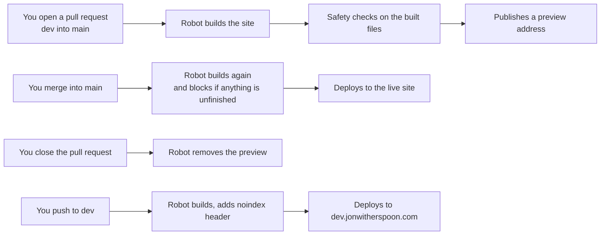

# GitHub Actions guide

This explains what the automatic build and deploy does, and the steps to switch it on. Tick each box as you go. For the rest of the setup (Azure, DNS, domain), see `docs/setup-guide.md`.

## What it does

GitHub Actions is a robot that runs on GitHub's computers. The robot's instructions are in one file, `.github/workflows/deploy.yml`.



In plain words:

- **Pull request into `main`:** the robot builds the site and publishes a temporary preview address. The address appears as a comment on the pull request. Previews are public, and the Free plan keeps 3 at a time.
- **Push to `main` (a merge):** the robot builds the site and deploys it to the live address. This is the strict run, see "What blocks a deploy".
- **Push to `dev`:** a separate job builds the site and deploys it to `dev.jonwitherspoon.com` using its own secret, `AZURE_STATIC_WEB_APPS_API_TOKEN_DEV`. Unfinished `[TO SUPPLY` text is allowed there, and every response carries `X-Robots-Tag: noindex, nofollow` so search engines skip it. The dev site is public (no login). The production job never runs on a push to `dev` and never sees the dev secret.
- **Closing a pull request:** the robot removes that pull request's preview.

Only pull requests from this same repository can deploy. Pull requests from forks and from Dependabot (the automatic update bot) never reach the deploy token.

The robot's steps, in order:

1. Check out the code.
2. Install Node (the version in `.node-version`, currently 22).
3. `npm ci` (installs exactly what `package-lock.json` lists, nothing newer).
4. `npm run build`.
5. `npm test` (run the tests). If a test fails, the run stops here and nothing is deployed.
6. Scan the built files for phone numbers and street addresses.
7. On a push to `main` only: fail if any `[TO SUPPLY` text is left.
8. Deploy the built `dist/` folder to Azure.

The dev job (push to `dev`) runs the same steps, including the tests, except that `[TO SUPPLY` text is allowed. It adds the noindex header just before it deploys to the dev site.

## What blocks a deploy

The run turns red (fails) and nothing is published if:

- any `[TO SUPPLY` placeholder remains in the built pages (production only; a preview just warns),
- the scan finds something that looks like a phone number or street address,
- the build or `npm ci` fails,
- a test fails (`npm test`),
- the secret `AZURE_STATIC_WEB_APPS_API_TOKEN` is missing or wrong (for a push to `dev`: `AZURE_STATIC_WEB_APPS_API_TOKEN_DEV`).

## Before you start

- [ ] You have the GitHub repository `jonwitherspoon.com` with `main` and `dev` pushed (setup guide section 1).
- [ ] You have the Azure Static Web App and its deployment token (setup guide section 3). Plan type Free, deployment source **Other**, not GitHub.

## Steps to switch it on

- [ ] **Add the secret.** In the GitHub repository: Settings > Secrets and variables > Actions > **New repository secret**. Name: `AZURE_STATIC_WEB_APPS_API_TOKEN`. Value: the token from Azure (Static Web App > **Manage deployment token**). Save. Do this before the first pull request, or the first run fails at the Deploy step.
- [ ] **Set the workflow permissions.** Settings > Actions > General > Workflow permissions: choose **Read repository contents permissions**. (The workflow asks for more only where it needs it, and only on the deploy job.)
- [ ] **Limit which actions can run.** Same page: allow only selected actions. If you see "Require actions to be pinned to a full-length commit SHA", turn it on. The workflow already pins every action to a full SHA, a fixed fingerprint of that action's code. The option may not appear on every plan.
- [ ] **Set up the dev site.** Follow setup guide section 4a: create the second Static Web App (Free, deployment source **Other**, for example `swa-jonwitherspoon-dev`), add its token as the secret `AZURE_STATIC_WEB_APPS_API_TOKEN_DEV`, add the custom domain `dev.jonwitherspoon.com` with **CNAME** validation, and in Cloudflare add a `CNAME` record named `dev` pointing to the dev app's `*.azurestaticapps.net` name, **DNS only**. Add the secret before the first push to `dev`.
- [ ] **Check the first dev push.** After it runs, confirm it landed on `dev.jonwitherspoon.com` and not on a preview address with `-dev.` in its name (the app's Environments page in Azure shows this).
- [ ] **Check the headers.** `curl -sI https://dev.jonwitherspoon.com/` must show `x-robots-tag: noindex, nofollow`; `curl -sI https://jonwitherspoon.com/` must not show `x-robots-tag`.
- [ ] **Turn on Dependabot.** Settings > Code security: turn on Dependabot alerts and Dependabot security updates. `.github/dependabot.yml` already asks for weekly update pull requests against `dev` for npm and for the actions themselves.
- [ ] **Protect `main`** (public repository). Settings > Rules > Rulesets: require a pull request and block force pushes and deletion on `main`.
- [ ] **Open the first pull request.** Make sure the workflow file is on `dev`, then open a pull request from `dev` into `main`.
- [ ] **Watch the run.** The pull request's **Checks** section shows the build. When it is green, a comment appears with the preview address.
- [ ] **Check the preview** (setup guide section 7 lists the exact `curl -sI` checks).
- [ ] **Merge into `main`** when the preview looks right and no `[TO SUPPLY` text is left. The merge triggers the production run.

## Checking a run from the terminal

These are read-only. Run each one on its own, from the project folder:

```
gh run list
gh run view --log
gh pr status
```

`gh run list` shows recent runs and whether they passed. `gh run view --log` shows the full log of a run, which is where the error is when one fails.

## If a run fails

| What you see | What it means | What to do |
|---|---|---|
| Fails at "Build", message says `[TO SUPPLY` | Only on a push to `main`: placeholder text is left | Fill them in `src/data/site.json` (see `docs/editing-guide.md`) |
| Fails at "Test" | A test failed, so nothing was deployed | Run `npm run build && npm test` locally and fix the failing test |
| Fails at "Check dist for phone and address patterns" | The scan matched text that looks like a phone number or address | Find it in the log, remove it from the source, and push again |
| Fails at "Deploy", mentions the token | Secret missing, misspelt or reset | Re-add `AZURE_STATIC_WEB_APPS_API_TOKEN` (see "Resetting the token") |
| A push to `dev` fails at "Deploy to the dev site", mentions the token | `AZURE_STATIC_WEB_APPS_API_TOKEN_DEV` missing, misspelt or reset | Re-add it from the dev app's deployment token |
| Fails at `npm ci` | `package.json` and `package-lock.json` disagree | Run `npm install` locally, commit the updated lock file |
| No run starts at all | Workflow not on the branch, or Actions disabled | Check `.github/workflows/deploy.yml` exists on the branch; Settings > Actions > General |
| A Dependabot pull request has no preview | By design | Dependabot pull requests never get the deploy token |

## Resetting the token

Do this if the token may have leaked, or once a year.

- [ ] Azure portal > the Static Web App > Manage deployment token > **Reset token**. Copy the new one.
- [ ] Update the GitHub secret `AZURE_STATIC_WEB_APPS_API_TOKEN` with the new value. For the dev site, do the same with the dev app and `AZURE_STATIC_WEB_APPS_API_TOKEN_DEV`.
- [ ] Re-run the latest workflow (Actions tab > the run > **Re-run all jobs**) to confirm it still deploys.

Never paste the token into a file, a chat or a commit.

## Rolling back

- [ ] In GitHub, open the merged pull request and press **Revert**, then merge the revert pull request. The robot redeploys the previous version.

## Keeping the actions up to date

Dependabot opens a weekly pull request when an action or npm package has a newer version. For the actions, the pull request changes the pinned SHA and its version comment together. Read it, check that the preview builds, and merge into `dev` like any other change.
