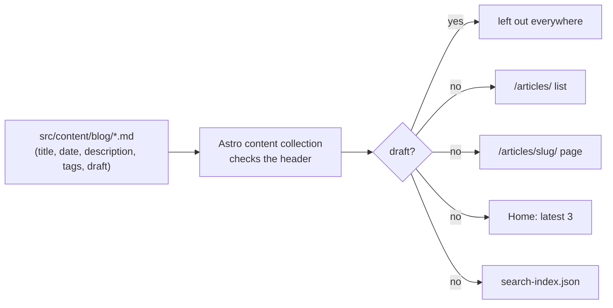

**Status:** Built and merged into dev on 2026-11-18 (branch plan/personal-site), with open items.  
**Open items:** QC Info findings in [qc-report-1](../../pipeline/2026-11-15-personal-site/qc-report-1.md) (a second .md file inside an article folder is read as an article; a missing banner or image error names the image but not the article; foo.md plus foo/index.md warns) and SEC-004 in [review-later](../../security/review-later.md).

# Blog (Articles) for jonwitherspoon.com

## Summary (one screen)

- **What it does:** Lets Jon publish articles by adding one Markdown file per article. Each article gets its own page, an Articles list page, and shows on Home and in search. No database, no login, no admin screen.
- **Images:** articles can include pictures in the text using plain Markdown. Give an article its own folder (`src/content/blog/my-title/index.md`) and put the pictures beside it. Astro resizes them at build time and publishes ordinary static files. Every image needs alt text (a short description for screen readers); the build fails if it is missing.
- **Banner image (optional):** add `cover: ./cover.png` and `coverAlt: Short description` to an article's header. The picture shows across the top of its card on the Articles list and on Home, and at the top of the article. An article without one gets a plain text card, as now. If `cover` is set, `coverAlt` is required.
- **Size:** Normal (a new feature across several files). Exposure: Public.
- **How Jon writes:** create `src/content/blog/my-title.md`, write, commit to `dev`, pull request to `main`. Steps go in `docs/editing-guide.md`.
- **Must controls:** no inline script and no inline style (the site's strict CSP stays unchanged); drafts never appear in any built page or in search; article text is Jon's own files only (no outside input).
- **Decided for Jon (change if you disagree):** static pages only; tags shared with projects (same chips and colours); plain code blocks without colour highlighting (see risks); `draft: true` hides an article; the old `articles` list in `site.json` is removed and replaced by these files.
- **Extras, not built unless Jon ticks them:** RSS feed, one page per tag, pagination, reading time, comments. (Pictures inside the article text and the optional banner image are included in version 1, per Jon 2026-11-16.)

## 1. How it works



A header mistake (missing title, bad date) stops the build with a clear message, so a broken article can never go live.

An article file looks like this:

```markdown
---
title: How I automated BitLocker
date: 2026-12-01
description: One sentence summary.
cover: ./cover.png          # optional banner image
coverAlt: Short description # required if cover is set
tags: [PowerShell, BitLocker]
draft: false
---

The article text, in Markdown.


```

Two ways to name an article: a single file `my-title.md` (no images), or a folder `my-title/index.md` with its images beside it. Both give the address `/articles/my-title/`.

## 2. Files

| File | Job |
|---|---|
| `src/content.config.ts` (new) | Defines the `blog` collection and its header rules |
| `src/lib/articles.js` (new) | `publishedArticles(entries)`: drops drafts, sorts newest first |
| `src/pages/articles/index.astro` (new) | List page with search box and tag chips |
| `src/pages/articles/[slug].astro` (new) | One article page |
| `src/pages/index.astro` (change) | Articles block reads the latest 3 from the collection |
| `src/pages/search-index.json.js` (change) | Adds articles |
| `src/layouts/Base.astro` (change) | Adds "Articles" to `navLinks` (footer follows) |
| `src/styles/site.css` (change) | Article text styling |
| `src/data/site.json` (change) | Remove the `articles` list |
| `tests/blog.test.mjs` (new), `tests/site.test.mjs` (change) | Tests |
| `docs/editing-guide.md` (change) | Replace "Add an article" with the Markdown steps |

`exam_apps/` is not touched.

## 3. Tasks

### Task 1: Collection and filter
- [ ] Test `tests/blog.test.mjs`: `publishedArticles` drops `draft: true`, sorts newest first, and returns `[]` for no entries.
- [ ] Run it, see it fail.
- [ ] Add `publishedArticles(entries: ArticleEntry[]): ArticleEntry[]` in `src/lib/articles.js`, and the `blog` collection (title string, date date, description string, tags string array defaulting to empty, draft boolean defaulting to false) in `src/content.config.ts` using the glob loader on `src/content/blog/**/*.md`.
- [ ] Run it, see it pass. Commit.

### Task 2: Pages
- [ ] Test (build-level, in `tests/blog.test.mjs`): with no articles, `/articles/` is built with an empty-state message, has one h1, a title, a description and canonical, loads `/search.js`, and has no inline script, no inline style and no `style=`.
- [ ] Build `/articles/` and `/articles/[slug]/` (static paths from `publishedArticles`). Reuse the projects page search panel markup and `chipTint` so tags look the same as on projects.
- [ ] Set `markdown.syntaxHighlight: false` in `astro.config.mjs` (see risks).
- [ ] Image test: a build with a temporary folder article holding a small PNG produces an optimized image file under `dist/_astro/`, the page's `` has non-empty `alt`, `width` and `height` (stops layout jumping), `loading="lazy"`, a same-origin `src`, and no inline style. An image with empty alt text fails the build (a small check in `src/lib/articles.js`: `findImagesWithoutAlt(markdown: string): string[]`, run from the page). The test also pins the `my-title/index.md` address to `/articles/my-title/` (not `/articles/my-title/index/`).
- [ ] Banner: add optional `cover` (an image reference, so Astro checks the file exists) and `coverAlt` to the collection, with a rule that `cover` without `coverAlt` fails the build. Cards on `/articles/` and Home show the image on top when present; the article page shows it above the text. Test: an article with a cover renders an optimized `` with alt, width, height, lazy loading (not lazy on the article page's own banner, since it is at the top), no inline style, and the Home and list cards carry it; an article without a cover renders a card with no `` and no empty gap; a cover without `coverAlt` fails the build. Cards keep a fixed picture shape (wide crop) so the grid stays even.
- [ ] Add `img` styling in `site.css`: full width up to the text column, rounded to match the cards, never wider than the screen.
- [ ] Run build and tests. Commit.

### Task 3: Home, search, nav
- [ ] Update the existing test "articles section is driven by site.json articles" so it expects the collection-driven block. Jon approves this test change by approving this plan; no agent changes tests otherwise.
- [ ] Home reads the latest 3 published articles; empty state stays when there are none. Add articles to `search-index.json` with `kind: 'article'`, same-origin url `/articles/<slug>/`. Add "Articles" to `navLinks`. Remove `articles` from `site.json`.
- [ ] Run build and tests. Commit.

### Task 4: Docs and a real-content check
- [ ] Replace "Add an article" in `docs/editing-guide.md` with: create the file or folder, the header fields, how to add a picture (copy it into the article folder, write ``), how to add a banner (`cover` and `coverAlt`), alt text, the 2 MB advice, draft, preview with `npm run build && npm run preview`, publish.
- [ ] QC adds a temporary published post and a temporary draft, builds, confirms the post appears on `/articles/`, its own page, Home and search, and the draft appears nowhere, then removes both. Nothing from this check is committed.

## 4. Risks and what the tests pin (Review Focus)

1. **Code blocks and the CSP.** Astro's default colour highlighter writes `style=""` attributes, which the strict CSP and the existing "no style=" tests forbid. The plan turns highlighting off. Colour highlighting could return later with a stylesheet-only approach, as a separate plan.
2. **Raw HTML in Markdown.** Markdown allows HTML, including `<script>`. The CSP blocks inline script, so it would not run, but a test builds an article containing `<script>` and fails if the output page contains an inline script tag.
3. **Bad header.** Missing title or invalid date fails the build with a named file (not tested by automation; QC tries it once by hand).
4. **Duplicate or odd file names.** Slugs come from file names; two files cannot share one. Spaces or capitals in file names produce clean lowercase addresses (checked in Task 2 test).
5. **Future dates.** An article dated in the future still publishes in v1. Jon should use `draft: true` to hold one back.
6. **Images.** A huge photo makes a slow page: Astro shrinks them at build time, but the original stays in the repo, so keep originals under about 2 MB. An external image address (`https://...`) is blocked by the CSP and the site's "no outside hosts" tests, so images must be files in the article folder; a test fails if a built article references an outside image host. Screenshots can contain private data (names, tenant IDs, addresses); check them before committing, since the git history keeps them. Image files from outside are untrusted input, so only use your own.
7. **Production placeholder guard** also scans article pages, so `[TO SUPPLY` in an article blocks production deploy, as for other pages.

## 5. Security and quality

Public site, so the standard flow applies: independent security review after tests pass, every run recorded in `docs/security/reviews/`, tracker in `docs/security/issues.md`. This feature adds no forms, no network calls, no cookies and no new dependencies (Astro already includes content collections, Markdown and image handling). Task 2's build confirms Astro's image tool works without installing anything; if it needs a new package, the build stops and the plan comes back to Jon first.

## 6. Questions for Jon

1. Approve this plan, change it, or leave it parked?
2. ~~Nav label~~ Decided by Jon 2026-11-16: "Articles".
3. Any extras to tick (RSS feed is the likeliest)?
