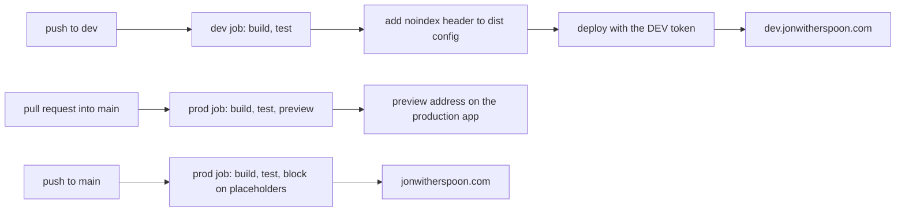

**Status:** Proposed, built after Jon reads it. Requested by Jon 2026-11-17 ("pushes to dev will need to go to a dev build site ... dev.jonwitherspoon.com"; "let's do both in azure"). Size: Normal. Exposure: Public.

# Dev site: dev.jonwitherspoon.com

## Summary (one screen)

- **What it does:** A push to the `dev` branch builds the site and deploys it to `dev.jonwitherspoon.com`. A push to `main` still deploys to `jonwitherspoon.com`. Everything stays in Azure and GitHub: no Cloudflare hosting.
- **How:** a second Azure Static Web App (Free plan, no cost) with its own deploy token. Azure cannot put a custom domain on a preview environment (Recon 05), so a separate app is the only way to get the dev address.
- **Pull requests:** unchanged. A pull request from `dev` into `main` still gets a temporary preview on the production app, with the real production config.
- **Dev differences:** placeholders (`[TO SUPPLY`) are allowed on dev and only block production; every dev response carries `X-Robots-Tag: noindex, nofollow` so search engines skip it.
- **Decided for Jon (change if you disagree):** the dev site is public (no login); a login is an extra, see below. The production secret keeps its name `AZURE_STATIC_WEB_APPS_API_TOKEN`; the new one is `AZURE_STATIC_WEB_APPS_API_TOKEN_DEV`. Two separate jobs, so each job can only see its own token.
- **Must controls:** the dev token is used only by the job that runs on a push to `dev`; the production token is never used on a `dev` push; dev responses are noindex; production responses are not; no new actions, no new dependencies; workflow keeps `contents: read` and pinned SHAs.
- **Extras, not built unless Jon ticks them:** a login for the dev site (Azure's free route is GitHub sign-in limited to an invited role, Recon 05 item 6); a `<meta name="robots">` noindex in dev pages; cancel-protection for production deploys; `--ignore-scripts`.

## How it works

The dev job's only difference from production is one extra step before deploying: a small script adds `"X-Robots-Tag": "noindex, nofollow"` to the `globalHeaders` of the built `staticwebapp.config.json`. The source config is never changed, so production cannot pick it up.

## Files

| File | Job |
|---|---|
| `.github/workflows/deploy.yml` (change) | Trigger on pushes to `dev` too; new `deploy_dev` job using the dev token with `production_branch: dev`; set `production_branch: main` explicitly on the production job |
| `scripts/make-dev-config.mjs` (new) | Reads `dist/staticwebapp.config.json`, adds the noindex header, writes it back; fails loudly if the file is missing or not valid JSON |
| `tests/devsite.test.mjs` (new) | Tests below |
| existing workflow tests (change) | Updated where the new job breaks them (Jon's relaxed test rule) |
| `docs/setup-guide.md`, `docs/github-actions-guide.md`, `docs/editing-guide.md` | The dev app, the second secret, the dev DNS record, the new publish flow |

`exam_apps/` is not touched.

## Tasks

### Task 1: The config script
- [ ] Tests: given a sample config, `addNoindexHeader(config: object): object` keeps every existing header and route and adds the `X-Robots-Tag` global header; run twice it changes nothing more; a missing or invalid file makes the script exit nonzero with a message; the real source `public/staticwebapp.config.json` never contains `X-Robots-Tag` (so production cannot carry it).
- [ ] Implement `scripts/make-dev-config.mjs` (exports the function; when run as a script it takes the dist path as its argument).

### Task 2: The workflow
- [ ] Tests (read `deploy.yml`): the dev job runs only for `push` to `refs/heads/dev`; it references `AZURE_STATIC_WEB_APPS_API_TOKEN_DEV` and never the production secret; the production job never references the dev secret; `production_branch` is `dev` on the dev job and `main` on the production job; the dev job runs `make-dev-config.mjs` before the deploy step; `FAIL_ON_PLACEHOLDER` is off for dev; the dev job has only `contents: read`; every `uses:` is still pinned to a full SHA and no new action is added.
- [ ] Implement in `deploy.yml`. The dev job repeats the checkout, Node, `npm ci`, build and test steps of the production job (two jobs rather than one shared job, so a job only ever sees its own token).
- [ ] Run the existing workflow tests; update only those this change breaks.

### Task 3: Docs
- [ ] `docs/setup-guide.md` and `docs/github-actions-guide.md`: create the second Static Web App (Free, deployment source Other, name for example `swa-jonwitherspoon-dev`); add its token as `AZURE_STATIC_WEB_APPS_API_TOKEN_DEV`; add the custom domain `dev.jonwitherspoon.com` (validation by CNAME); in Cloudflare add `CNAME dev` to the dev app's `*.azurestaticapps.net` name, DNS only; checks: `curl -sI https://dev.jonwitherspoon.com/` shows `x-robots-tag: noindex, nofollow` and the production site does not.
- [ ] `docs/editing-guide.md`: publishing is now "push to dev, look at dev.jonwitherspoon.com, open a pull request into main".
- [ ] Run `npm run build && npm test` (one at a time, three times).

## Risks and what the tests pin (Review Focus)

1. **Noindex leaking to production.** Pinned: the source config has no `X-Robots-Tag`, and only the dev job runs the script.
2. **Dev push deploying to production or the reverse.** Pinned by the secret and `production_branch` tests. Not testable here: what Azure does if a token's app has a different production branch (Recon 05: undocumented). The setup guide has Jon check that the first dev push lands on the dev address and not on a `-dev.` preview address.
3. **Dev job sees the production token.** Pinned: separate jobs, each references only its own secret.
4. **Dev site shows unfinished content.** It is public by design in this plan, with noindex; the extras list has the login. Dev pages still carry the production canonical link, which points search engines at the real site.
5. **Free plan limits.** Two Free apps share 100 GB per month of bandwidth (Recon 05); fine for a personal site.
6. **First run depends on Jon's setup.** Until the second app and `AZURE_STATIC_WEB_APPS_API_TOKEN_DEV` exist, a push to `dev` fails at the Deploy step. The guide orders the steps so the secret comes before the first push.

## Security

Public site: independent security review applies. This adds one credential (the dev token, which can only replace the dev site), no new actions and no new dependencies. The production token and workflow permissions are unchanged.
