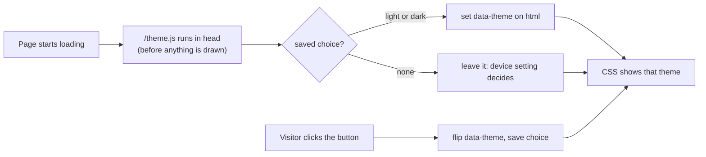

**Status:** In progress. Requested by Jon 2026-11-17 ("there needs to be a toggle"). Built on branch plan/personal-site as part of the prototype revision. Size: Small. Exposure: Public.

# Light / dark mode toggle

## Summary (one screen)

- **What it does:** A button in the header switches the site between light and dark. The first visit follows the visitor's device setting (as today). Once they click, the choice is remembered on that device and used on every page.
- **Without JavaScript:** no button appears, and the site keeps following the device setting, so nothing is lost.
- **Must controls:** no inline script and no inline style (the strict CSP stays unchanged); the saved value is only ever "light" or "dark" (anything else is ignored); storage errors never break the page; no cookie, no network call, no new dependency.
- **Decided for Jon (change if you disagree):** a two-state button (light / dark) rather than three states with "auto"; a visitor who wants to follow the device again clears site data; the lab apps under `/exam_apps/` are separate pages and are not touched.
- **Extras, not built unless Jon ticks them:** a third "follow device" state; a smooth colour fade.

## How it works

The script is a small separate file, loaded in the page head without `defer`, so the right colours are in place before the page is drawn (no flash of the wrong theme). It is a normal same-site file, so the CSP allows it.

## Files

| File | Job |
|---|---|
| `public/theme.js` (new) | Reads the saved choice, sets `data-theme` on `<html>` early; after load, wires the button to flip and save |
| `src/layouts/Base.astro` | Loads `/theme.js` in the head; adds the toggle button to the header next to Search |
| `src/data/icons.js` | Sun and moon icons |
| `src/styles/site.css` | Dark colours apply when `data-theme="dark"`, or when the device is dark and no choice is set; light colours when `data-theme="light"`; button styling; the button is hidden until the script adds a class |
| `tests/theme.test.mjs` (new), `tests/site.test.mjs` (change) | Tests |
| `docs/editing-guide.md` | A short note on how the theme works and where colours live |

`exam_apps/` is not touched.

## Tasks

### Task 1: CSS
- [ ] Test: the dark variable block under the device media query and the block for `:root[data-theme="dark"]` declare exactly the same variables and values (so they cannot drift apart), and `[data-theme="light"]` restores the light values. The existing contrast test is extended to check the manual dark and light blocks too.
- [ ] Implement in `site.css`. The same variable list necessarily appears twice (CSS cannot share one block between a media query and an attribute selector); the test above guards it. Set `color-scheme` to match.

### Task 2: Script and button
- [ ] Tests (`tests/theme.test.mjs`, run in Node with a small fake `document` and `localStorage`): saved "dark" sets `data-theme="dark"`; saved junk such as "banana" is ignored; storage that throws does not throw out of the script; a click flips light to dark and back, saves it, and updates the button's label and `aria-pressed`.
- [ ] Build-level tests: every page loads `/theme.js` in the head, not deferred; no inline script, no inline style; the header has a button with a visible text label and a hidden-until-JS class; `theme.js` uses no `eval` or `innerHTML`.
- [ ] Implement `public/theme.js` and the header button. The button label says what a click does ("Dark mode" / "Light mode") and carries `aria-pressed`.
- [ ] Update the existing test "every page loads /search.js (deferred)..." to also allow `/theme.js` (this plan breaks it; Jon's rule allows that edit).

### Task 3: Docs and check
- [ ] Add the short note to `docs/editing-guide.md`.
- [ ] Run `npm run build && npm test` one at a time, three times.

## Risks and what the tests pin

1. **Flash of the wrong theme.** Pinned by the "head, not deferred" test.
2. **Dark and light blocks drifting apart** when someone edits a colour in one place. Pinned by the identical-blocks test.
3. **Saved junk or blocked storage** (private windows). Pinned by the junk and throwing-storage tests.
4. **Contrast** in both manual modes. Pinned by the extended contrast test.
5. **Keyboard and screen readers.** The control is a real button with a text label and `aria-pressed`.

## Security

Public site, so the standard review applies later. This feature adds no forms, no network calls, no cookies and no dependencies.
