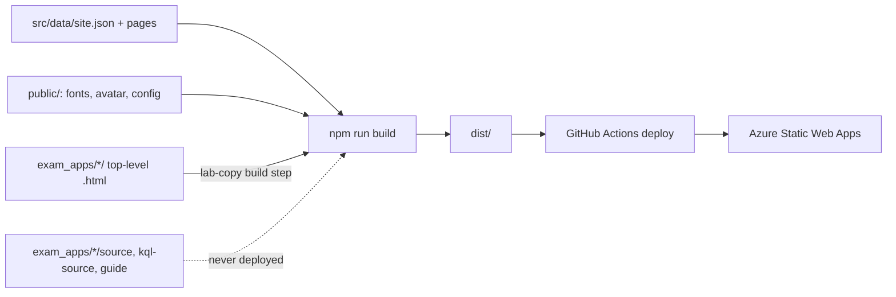

**Status:** Proposed. Written 2026-11-15 by the devpipeline orchestrator. Shown to Jon with the prototype.

# jonwitherspoon.com personal site

## Summary (one screen)

- **What it does:** A fast, static Astro site for Jon: Home, Work (current role plus career history, skills, certifications, education), Projects (best work as cards), and Labs (a hub of certification study apps, starting with MD-102 and the KQL lab). Deployed to Azure Static Web Apps by GitHub Actions.
- **Size:** Normal, because it is a multi-file site, but it handles no secrets beyond one deploy token.
- **Exposure:** Public, because it is on the internet; Critical, High and Medium security findings block the merge.
- **Code-size target:** about 250 lines .astro, 150 lines CSS, 100 lines JSON, 50 lines workflow YAML, 40 lines config JSON, 20 lines JS (build guard).
- **Must controls:** token only as a GitHub secret; workflow `contents: read`, actions pinned by SHA, no fork-PR deploys; strict header CSP with no inline code on the main site; looser CSP only on the `/exam_apps*` route; Jon's study apps are never modified by the pipeline; only `dist/` deploys (app source stays out); no private info on the site; self-hosted fonts and avatar; astro >= 6.4.8.
- **Optional hardening (your call):** `npm ci --ignore-scripts`; 7-day Dependabot cooldown; registrar forwarding of www to apex; QC script that every lab folder has a CSP route.
- **CVE highlights:** none actively exploited; `npm audit` still reports Astro 6.4.8 advisories (fixes only in Astro 7) that the CVE follow-up judged not to affect a static site, so we stay on 6.x with a written exception and plan the Astro 7 upgrade on its own branch (`cve/report-2.md`). Require astro >= 6.4.8 and Vite >= 7.3.5; pin GitHub Actions to SHAs (2026 tag-hijack and npm worm campaigns). Full list: `docs/pipeline/2026-11-15-personal-site/cve/report.md`.
- **Decided for you:** apex `jonwitherspoon.com` is the canonical address; one CSP route `/exam_apps*` covers every lab; projects are cards, not detail pages; no JavaScript, no theme toggle (follows system light/dark); production deploy fails while `[TO SUPPLY]` placeholders remain; Silicon Scripted branding left out (small footer link to the old site).

## 1. What we are building, in one paragraph

A personal site for Jon on his new domain. It carries his career (old site content moved over, rewritten About, new current role at Critical Network Solutions), a projects showcase, and a Labs page that lists the practice apps he builds for certifications. The MD-102 app already exists as a single HTML file and moves to `/exam_apps/md-102/` with all future labs under `exam_apps/`; it is not published yet, so no saved progress is lost, and progress lives only in each visitor's own browser. The blog, knowledge base, codebase and legal pages are not moved.

## 2. How it works

Pages read one data file, `src/data/site.json` (profile, experience, projects, certifications, skills, labs). Astro copies everything in `public/` untouched into `dist/`, which is the only thing deployed. Each lab lives whole in `exam_apps/<code>/`, exactly as Jon wrote it (`index.html` beside `source/`). A small `lab-copy` build step copies only the top-level `.html` pages into `dist/exam_apps/<code>/`; sources, scripts and the guide never deploy.

## 3. User experience

- **Pages:** `/` Home, `/work/`, `/projects/`, `/labs/`, `/exam_apps/md-102/` (existing app), `/404`. Nav: name left; Work, Projects, Labs, GitHub, LinkedIn right. No hamburger.
- **Home:** avatar (96px, saved in the repo), name, one-line role in monospace, two-sentence intro, a "Now" block (current role, studying MD-102 with a link), three featured projects.
- **Work:** one scrolling page, numbered headers (`01 / Experience`), changelog-style entries (monospace dates left, role right), Critical Network Solutions first marked `current`; then Skills, Certifications, Education.
- **Projects:** cards from JSON (title, one line, tags, status) linking to the repo or demo. The five projects from the old site.
- **Labs:** one row per app: exam code in large monospace, name, status (live, in progress, planned), updated date, Open link. KQL Lab sits under MD-102. A planned lab shows no link.
- **md-102:** opens as its own page in the same tab, exactly as Jon wrote it (no back link, no rebuild). Visitors return with the browser's Back button or the site's Labs link. Adding a back link is a possible later change, only if Jon asks.
- **Look:** IBM Plex Sans and Mono (self-hosted, Latin subset, OFL.txt committed); warm off-white in light, graphite in dark; one signal-amber accent (about `#B26B00` light, `#E8A33D` dark), AA contrast; 1px rules, 2-4px radius; no shadows, gradients, glow, emoji or animation; left-aligned uneven two-column grid. Footer: `built <UTC date> · <first 7 of GITHUB_SHA or "local">`, no commit link.
- **Placeholders:** shown as `[TO SUPPLY: ...]` with a dashed amber outline (a CSS class, never inline style).
- **Edge cases:** custom 404 with links; works with JavaScript off; layout is one column under 640px, 44px tap targets, no sideways scroll at 390px; skip link, visible focus, one h1 per page, `prefers-reduced-motion`.

## 4. Security requirements (all "must")

1. Deploy token stored only as the repo secret `AZURE_STATIC_WEB_APPS_API_TOKEN`. Risk: site takeover. Never commit tokens, `.env*`, or `swa-cli.config.json`.
2. Workflow: top-level `permissions: contents: read`; no `id-token: write`; no `pull_request_target`; no `${{ github.event.* }}` inside `run:`. Deploy and close jobs run only for same-repo PRs and pushes to `main`, never for forks or `dependabot[bot]`. `pull-requests: write` only on the deploy job.
3. Actions pinned by full SHA: checkout `3d3c42e5aac5ba805825da76410c181273ba90b1` (v7.0.1), setup-node `949feb2413d6458794dcd2491c4babbbce0c15c1` (v7.1.0), deploy `1a947af9992250f3bc2e68ad0754c0b0c11566c9` (v1). Re-check against the tags API when building. `.github/dependabot.yml` (github-actions, npm, weekly, `target-branch: dev`).
4. Supply chain: `package-lock.json` committed, `npm ci` only, `astro` `^6.4.8` with Vite resolving to >= 7.3.5 (or >= 8.0.16), dependencies = Astro only.
5. Headers (`public/staticwebapp.config.json`, under 20 KB): HSTS `max-age=31536000; includeSubDomains` (no preload), `X-Content-Type-Options: nosniff`, `Referrer-Policy: strict-origin-when-cross-origin`, `Permissions-Policy: camera=(), microphone=(), geolocation=()`, `X-Frame-Options: DENY`, and CSP `default-src 'self'; img-src 'self' data:; object-src 'none'; base-uri 'self'; form-action 'none'; frame-ancestors 'none'`. No `X-XSS-Protection`. No Astro `security.csp`; `build.inlineStylesheets: 'never'`, no inline `<script>`, `<style>` or `style=`.
6. Lab routes: the route is `/exam_apps*` (Recon: a `/x/*` route does not match the folder root `/x/`), placed before any general rule (first match wins). It gets a full replacement CSP: `default-src 'self'; script-src 'self' 'unsafe-inline'; style-src 'self' 'unsafe-inline'; img-src 'self' data:; font-src 'self'; connect-src 'none'; object-src 'none'; base-uri 'self'; form-action 'none'; frame-ancestors 'none'`. Jon's apps still load Google Fonts, so on this route only `style-src` also allows `https://fonts.googleapis.com` and `font-src` allows `https://fonts.gstatic.com`. New labs go in `exam_apps/<code>/` and need no CSP edit (one prefix route covers them).
   Config also holds `"responseOverrides": {"404": {"rewrite": "/404.html"}}` and NO `navigationFallback` (it would turn missing pages into 200s).
7. Only `dist/` deploys; `exam_apps/` stays in the repo and only its top-level `.html` pages are copied into `dist/`; `dist/` has no `source/`, `kql-source/`, `.md`, `.sh` or `.DS_Store`. Jon's app files are read-only for the pipeline.
8. No phone, address or date of birth on the site; contact is GitHub and LinkedIn links. Avatar and fonts are self-hosted on the main site (no Google requests there).
9. Build guard: warns on `[TO SUPPLY`; on pushes to `main` the workflow fails if any remain.

Must not: `unsafe-inline`/`unsafe-eval` or CDN script hosts on the main site; unpinned `npm install` in CI.

## 5. Operations

- Astro 6 only, Node 22.12+ (`.node-version` = 22, `engines >=22.12`), npm scripts `dev`, `build`, `preview`. The lab pages are copied during `npm run build`, so to try the site with labs run `npm run build && npm run preview` (the dev server does not serve them; making it do so is a hardening item). `.gitattributes`: `* text=auto eol=lf`.
- Workflow `.github/workflows/deploy.yml`: checkout (`persist-credentials: false`) -> setup-node (`node-version-file`) -> `npm ci` -> `npm run build` -> placeholder/private-info grep on `dist/` -> deploy with `app_location: dist`, `output_location: ""`, `skip_app_build: true`, `skip_api_build: true`. Close job on PR close. `main` = production; PRs from `dev` get preview environments (Free plan: 3, public URLs, acceptable since content is public).
- Domains: apex `jonwitherspoon.com` is canonical; add apex and www as custom domains (Free allows 2). SWA has no www/apex redirect; use registrar forwarding only if it forwards over HTTPS. Apex needs TXT plus ALIAS/ANAME or flattening, or Azure DNS (~$0.50/month). Every page has `<link rel="canonical">` to the apex.
- Repo visibility matters (Recon 02): on a Free personal account, a private repo has no branch protection/rulesets and no secret-scanning push protection; Dependabot works either way. A public repo gets all of them, and the site content is public anyway. Recommended: public. The guide gives checkboxes for whichever Jon picks.
- `docs/setup-guide.md` (plain language, checkboxes): create the GitHub repo and push `main` and `dev`; GitHub settings (2FA, ruleset on `main` and secret scanning if public, read-only workflow token, Actions allow-list and SHA-pinning policy if offered, Dependabot); Azure (MFA, own resource group, Free plan, source "Other", token reset path); add the secret; first deploy; custom domains; post-deploy checks.
- Post-deploy checks (Jon runs): `curl -sI` on `/`, `/work/`, `/exam_apps/md-102/`, `/exam_apps/md-102`, `/exam_apps/md-102/kql-lab.html`, `/nope`, and `http://` on apex and www, on production and a preview: all headers present, main CSP has no `unsafe-inline`, lab CSP on lab paths, 404 has headers, HTTP redirects to HTTPS.
- Study apps: Jon's whole `md-102/` folder was moved unchanged to `exam_apps/md-102/` (pure rename, commit `ee564a0`; his later edits are committed separately). Nothing in `exam_apps/` is rebuilt or edited by the pipeline. The site's `exam_apps/package.json` (`"type": "commonjs"`) keeps his `require`-based scripts working under the site's ESM package. The setup guide's "Add a new lab" section covers new labs: create `exam_apps/<code>/` with its `index.html` beside its source, add a `labs[]` entry; no copy and no CSP edit.

## 6. Work split

| Developer | Files (no overlap) | Interface it provides or uses |
|---|---|---|
| Front-end | `src/pages/{index,work,projects,labs,404}.astro`, `src/layouts/Base.astro`, `src/styles/site.css`, `src/data/site.json`, `public/avatar.jpg`, `public/fonts/*` | Reads `site.json`; build stamp from `process.env.GITHUB_SHA` |
| Back-end | `package.json`, `package-lock.json`, `astro.config.mjs` (including placeholder guard), `.node-version`, `.gitattributes`, `.github/workflows/deploy.yml`, `.github/dependabot.yml`, `public/staticwebapp.config.json`, `lab-copy` build step, `docs/setup-guide.md`, `.gitignore` additions | Provides the build and the config; consumes `dist/` |

## 7. Acceptance criteria

1. `npm ci && npm run build` succeeds on Node 22.12+; `dist/` contains pages for `/`, `/work/`, `/projects/`, `/labs/`, `/404`, `/exam_apps/md-102/index.html`, `/exam_apps/md-102/kql-lab.html`.
2. Home shows avatar, name, role, "Now" block, three featured projects; nav has Work, Projects, Labs and GitHub/LinkedIn.
3. Work lists Critical Network Solutions first with a `current` label (placeholder fields visible), then Enable Resource Group, Southeastern Computer Associates, DWK Lifesciences, K12; skills, six certifications plus past exams, and education from the old site.
4. Projects shows the five old projects; Labs shows MD-102 (live) with KQL Lab as companion and any planned entry without a link.
5. Main pages in `dist/` (outside `exam_apps/`) contain no `<script`, `<style` or `style=`; no external hosts in any main-page asset reference.
6. `staticwebapp.config.json` is in `dist/`, valid JSON under 20 KB, with exactly the headers and CSPs in section 4, and an `/exam_apps*` route listed first.
7. `dist/` has no `source/`, `kql-source/`, `.md`, or `.DS_Store` files, and no phone or address patterns.
8. Workflow: `permissions` set at top, no `pull_request_target`, all three actions pinned to the SHAs above, `npm ci`, no fork-PR deploy, token only via `secrets.`, same-repo guard present.
9. `package.json` has Astro as only dependency with `^6.4.8`; `npm ls vite` meets the floor; `npm audit --omit=dev --audit-level=high` is expected to report Astro 6.x advisories that do not apply to a static build (documented exception in `cve/report-2.md`); it is not a CI gate until the Astro 7 upgrade.
10. Build prints a warning listing files containing `[TO SUPPLY`; with `FAIL_ON_PLACEHOLDER=1` the build fails.
11. (Changed by Jon) Study apps are untouched: the build copies each `exam_apps/<code>/` top-level `.html` byte-for-byte into `dist/exam_apps/<code>/`, and nothing else from `exam_apps/` deploys.
12. Light and dark follow `prefers-color-scheme`; keyboard focus visible; skip link present; one h1 per page; no horizontal scroll at 390px.
13. Main-site fonts load from `/fonts/` with a system fallback; the IBM Plex `LICENSE.txt` (SIL OFL 1.1) is committed beside them; font files come from the official IBM/plex repo (Latin1 split woff2; curly quotes, dashes and euro sign checked, add Latin2 if any are missing); avatar is a local file with no EXIF/GPS.
14. `docs/setup-guide.md` covers every step in section 5 in plain language.
15. Informational scan of `exam_apps/md-102/*.html` (reported, not failed, because the apps are not modified): external hosts (Google Fonts expected), `<iframe`, `eval(`/`new Function`, `blob:`; and the config `/exam_apps*` route matches `/exam_apps/md-102`, `/exam_apps/md-102/` and `/exam_apps/md-102/kql-lab.html`.
16. (Changed by Jon) Report only: where the app applies imported backup data and whether it reaches `innerHTML` unescaped. No fix is applied unless Jon asks.
17. The About text is a draft rewrite, marked for Jon's review (the old one has typos and mentions Silicon Scripted).
18. (Changed by Jon) Report only: whether the shipped MD-102 and KQL files carry Jon's personal study data (preset exam or plan dates, seeded progress, sample backups, name, email), whether progress lives only in the visitor's browser, and whether the apps make network calls. Findings go to Jon; nothing is changed. The question bank stays.

## 8. Decisions made by the council

- Self-host IBM Plex fonts: must (security and UX agreed; main CSP has `font-src 'self'`).
- Projects: cards only, no `/projects/<slug>/` pages (ops and UX agreed; notes are one paragraph each).
- Lab CSP: one route `/exam_apps*` covers every lab because Jon put all labs in one `exam_apps` folder (replaces the council's per-exam routes; trade-off: no per-lab fail-safe, so a test checks that `dist/exam_apps/` holds only `.html` pages).
- Canonical domain: apex (UX, resume-friendly) over www (ops); both added.
- Placeholders: warn in builds, fail the production deploy while any remain (security).
- Skip Oryx: build with our own `npm ci`; `skip_app_build: true` (ops and security agreed).
- Header CSP over Astro meta CSP (security): header carries `frame-ancestors`, is curl-testable.

## 9. Questions for the prototype review

1. Approve the prototype for hardening, change it, or stop. (Recommended: approve once you have looked at it.)
2. Your apps and "usable by others": the shipped MD-102 app defaults the exam date to 2026-11-21, and the backup restore does not validate imported numbers. I changed nothing. Do you make those changes yourself, authorize exactly those two changes, or ship as is? (Recommended: you make them, since you edit the app daily.)
3. Setup facts: GitHub repo name and visibility (recommended `jonwitherspoon.com`, public, so branch protection and secret scanning work on a Free account), and which registrar holds jonwitherspoon.com.

Not decisions, content to send when ready: Critical Network Solutions title, start month, location or remote, 3-5 bullets, technologies; review of the draft About text; whether Budgetry may be shown. The production deploy refuses to run until every `[TO SUPPLY]` placeholder is gone.

Hardening items already known: six QC crashes on missing optional fields in `site.json` (and the setup guide's lab-entry instructions, which break the build if followed exactly); the placeholder guard should also catch `[DRAFT`; a 44px tap-target rule on the home "All projects" link; make labs available in the dev server.

## 10. Sources

`docs/pipeline/2026-11-15-personal-site/council/`, `recon/01-azure-swa-actions-astro.md`, `recon/02-github-swa-routes-fonts.md`, `cve/report.md`, `cve/report-2.md`.
