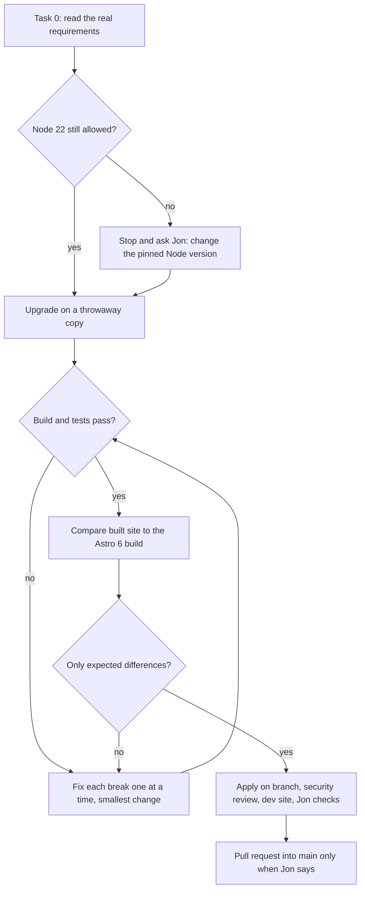

**Status:** Proposed. Written 2026-11-22, not started. Needs Jon's approval before any work.

# Upgrade Astro 6 to Astro 7

## Summary (one screen)

- **Why:** GitHub's Dependabot reports 12 open alerts (1 critical, 3 high, 5 medium, 3 low). They come from three packages: `astro` 6.4.8, `sharp` 0.34.5 and `esbuild` 0.27.7. Every fix is in Astro 7 (7.4.7 is the newest fix named in the alerts), sharp 0.35.5 and esbuild 0.28.1. No Astro 6 release has a fix.
- **How much they matter here:** little today. The site is static, so visitors get finished files and never reach Astro's code. The critical and high alerts need Astro or sharp to process an untrusted image, and every image here is committed by Jon. The medium and low XSS alerts are in features this site does not use (JSX/MDX, View Transitions, hydrated islands). The esbuild alert is for a Windows dev server. This is housekeeping, but it should be done: the earlier "no image pipeline" reasoning (SEC-003) stopped being true when blog images arrived, and the alerts will keep growing.
- **What changes:** Astro, sharp and esbuild versions in `package.json` and the lock file. Config and page changes only where Astro 7 breaks something.
- **What stays the same:** the look, the content, the strict Content Security Policy (no inline script or style), the deploy workflow.
- **Must controls:** the built site is the same as before apart from deliberate differences listed in the report; the CSP stays unchanged; no new dependency beyond the three upgraded packages (and `@astrojs/markdown-remark` only if the Markdown check below needs it).
- **Decided for Jon (change if you disagree):** do it on its own branch cut from `dev`; upgrade to the newest 7.x that clears all alerts; stop and report instead of working around anything that needs a design choice.
- **Extras, not built unless Jon ticks them:** none.

## What is known and not known

The Astro 7 upgrade guide (docs.astro.build/en/guides/upgrade-to/v7/) was read on 2026-11-22. It says:

| Change in Astro 7 | Does it touch this site? |
|---|---|
| Vite 8 replaces the old Vite | Only if code uses Vite internals. `astro.config.mjs` does not. The tests use a per-copy Vite cache folder (`node_modules/.vite`), so check that still works. |
| Default Markdown processor is now Satteri, not remark/rehype; `@astrojs/markdown-remark` is no longer installed by default | **Yes, high risk.** Articles are Markdown, and `astro.config.mjs` sets `markdown: { syntaxHighlight: false }` because the default colour highlighter writes `style=""` attributes that the CSP forbids. The guide does not say whether that option still exists. Unverified. |
| `compressHTML` default changes from `true` to `'jsx'` | **Yes.** Inline elements next to each other can lose the space between them (`a<em>b</em>` renders "ab"). Pages and tags need checking; the fix is `{" "}` or setting `compressHTML: true`. |
| New Rust compiler: unclosed tags error, bad nesting (a `
` inside a `
`) is no longer auto-corrected | Possibly. Any `.astro` file with sloppy markup fails the build. |
| CSS output changes cosmetically (for example `rebeccapurple` becomes `#639`) | The contrast and theme tests read the built CSS, so some may need updating. |
| Experimental flags removed; `src/fetch.ts` is a reserved name | No. Neither is used. |

Not covered by the guide, so unverified: the content-collection `glob` loader, `astro:assets` with sharp, `build.inlineStylesheets: 'never'`, and the `astro:build:done` hook (used by `placeholderGuard` and `labCopy`). Also not found: the Node version Astro 7 requires (the repo pins Node 22 in `.node-version`; the dev Mac runs Node 26) and the sharp version Astro 7 needs.

**Task 0 settles all of these before anything is changed.**

## How it works

## Files

| File | Job |
|---|---|
| `package.json`, `package-lock.json` | New versions of `astro`, `sharp`, `esbuild` (and anything else the upgrade tool moves) |
| `astro.config.mjs` | Markdown, `compressHTML` and integration-hook changes if needed |
| `.node-version`, `.github/workflows/deploy.yml` | Only if Astro 7 needs a newer Node |
| `src/pages/**`, `src/layouts/**` | Only to fix markup the new compiler rejects or whitespace it changes |
| `tests/**` | Update tests an Astro 7 change breaks (Jon's rule allows this; list them in the report) |
| `docs/security/issues.md`, `review-later.md` | Record the 12 alerts and close them after the review run confirms |

`exam_apps/` is not touched.

## Tasks

### Task 0: Find out (no code changes)
- [ ] Read the Astro 7 release notes and the `astro` package's `engines` and `dependencies` on npm: required Node version, latest 7.x number, sharp version it needs.
- [ ] Check whether `markdown.syntaxHighlight: false` still exists in Astro 7 and what the new Markdown processor writes for code blocks and images.
- [ ] If Node 22 is no longer allowed, stop and ask Jon before changing `.node-version` or the workflow.

### Task 1: Upgrade in a throwaway copy
- [ ] Copy the project (not `exam_apps/` build scripts; nothing is run against it), run `npx @astrojs/upgrade`, bump `sharp` and `esbuild` if the upgrade leaves them behind, then `npm ci`.
- [ ] `npm run build`. Fix each failure with the smallest change. List every change made.

### Task 2: Compare the built site
- [ ] Build the current `dev` (Astro 6) and the upgraded copy; compare the `dist/` folders. Expected differences are written down; anything else is investigated.
- [ ] Specific checks: no `style=` attribute and no inline script on any main page; the CSP header and `staticwebapp.config.json` are unchanged; spaces between inline elements (tag chips, buttons, footer); article page with an image and a code block; image output works (sharp).
- [ ] Update any existing test the upgrade breaks and list each one.

### Task 3: Apply and check
- [ ] Apply the same changes on the plan branch cut from `dev`. Run `npm run build && npm test` one at a time, three times.
- [ ] Independent security review (a new run file in `docs/security/reviews/`), then confirm Dependabot shows the alerts closed after the merge to `dev`.
- [ ] Push to `dev`, check `dev.jonwitherspoon.com` in a browser (look, theme toggle, search, an article, phone view).

## Risks and what the tests pin

1. **Markdown output breaks the CSP.** Pinned by the existing tests that fail on `style=` and inline script, plus the article fixtures in `tests/fixtures/blog/`.
2. **Spaces disappear between inline items.** Not pinned today. Add a test for the places that matter once Task 2 shows where.
3. **Newer Node needed.** Task 0 finds out first; changing it is Jon's decision.
4. **A fix is not available for every alert.** Re-check the alert list after the upgrade; log anything left in `docs/security/review-later.md`.
5. **Vite cache clash in tests.** The throwaway-copy tests use a per-copy cache; confirm it still works under Vite 8 by running the suite three times.

## Security

Public site, so the standard review applies. This upgrade adds no forms, network calls or cookies. It removes known-vulnerable versions; the review confirms the lock file and the built output.

## Not part of this plan

Upgrading other packages for their own sake, and changing the site's look or content.
